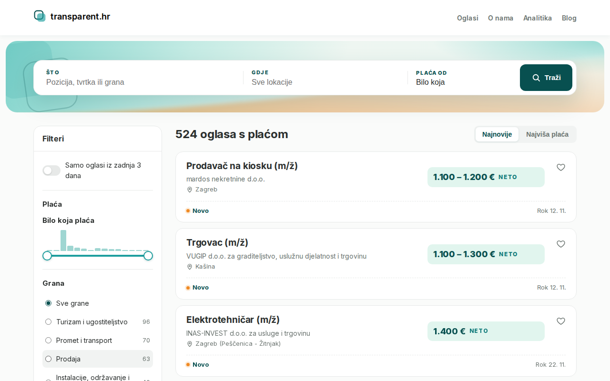
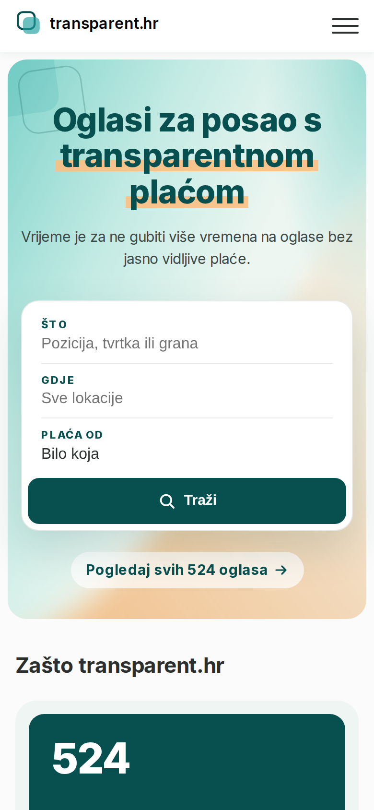
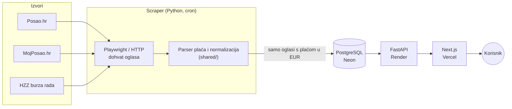

# transparent.hr

[](https://github.com/almicaa/transparent.hr/actions/workflows/tests.yml)

**Oglasi za posao u Hrvatskoj, ali samo oni u kojima piše plaća.** → [www.transparent.hr](https://www.transparent.hr)

Na hrvatskim portalima velik dio oglasa nema navedenu plaću ("po dogovoru"). transparent.hr redovito skuplja oglase s Posao.hr, MojPosao.hr i HZZ burze rada, zadržava samo one sa stvarnim iznosom u EUR i prikazuje ih na jednom mjestu, s filtrima po plaći, grani i gradu.



<p align="center"></p>

### U brojkama

- **524** aktivna oglasa s vidljivom plaćom (studeni 2026.)
- **3** izvora: Posao.hr, MojPosao.hr, HZZ
- **60** testova za parser plaća, pokreću se na svaki push
<!-- TODO: dodati broj posjeta iz Google Analyticsa -->

### Arhitektura



### Zanimljiviji dijelovi

- **Parser plaća** ([shared/salary_parser.py](shared/salary_parser.py)) čita formate kao `1.450 €`, `1 450 €`, `od 1.500 do 2.000 EUR neto`, `3000+ EUR` i `€1500`. Razlikuje raspon, "od", "do", "iznad" i fiksni iznos, te neto i bruto. Testovi su u [tests/test_salary_parser.py](tests/test_salary_parser.py).
- **Tri različita načina dohvata:** Posao.hr kroz headless Chromium, MojPosao kroz njihov search API, HZZ kroz RSS feedove po kategorijama i stranice detalja oglasa.
- **Normalizacija:** grane i lokacije s različitih portala mapiraju se na zajedničke liste. Oglasi koji se razlikuju samo po lokaciji grupiraju se u jedan.
- **Frontend:** Next.js App Router, strukturirani podaci `JobPosting` za Google, spremanje oglasa bez registracije, stranica s analitikom plaća i Markdown blog.

---

# Setup upute

## Struktura

```
transparent.hr/
  backend/    FastAPI, clean architecture (api/core/models/schemas/services/repositories)
  frontend/   Next.js 14 App Router, TypeScript
  scraper/    scraperi: posao.hr, mojposao.hr, HZZ
  shared/     parser plaća i normalizacija (grane, lokacije) za scraper i backend
  tests/      pytest testovi
  infra/      deploy konfiguracija (Render, Vercel, Neon)
```

## 1. Priprema (jednom)

```bash
cd ~/jobsrh

# Backend venv
python3 -m venv .venv
source .venv/bin/activate
pip install -r requirements.txt
playwright install chromium

# Frontend
cd frontend
npm install
cd ..
```

## 2. Pokreni scraper

```bash
source .venv/bin/activate
python run_all_scrapers.py --max_jobs 20
```

Scraper će:
- Skenirati Posao.hr (headless Chromium), MojPosao.hr (API) i HZZ (RSS + detalji oglasa)
- Zadržati samo oglase s vidljivom plaćom (EUR)
- Spremiti ih u `backend/jobs.db`

Kategorije (grane) čitaju se s detalja oglasa i mapiraju na zajedničku listu u `shared/category_normalizer.py`. Rok prijave se čita s detalja oglasa; oglasi bez roka skrivaju se i brišu nakon 40 dana. Za oglase spremljene prije toga:

```bash
python -m scraper.backfill          # dopuni kategorije i rokove prijave, deaktiviraj uklonjene oglase
python -m scraper.backfill --remap  # samo ponovno mapiraj kategorije nakon izmjene pravila (bez scrapanja)
```

> Selektori se mogu promijeniti na izvoru — koristi `scraper/debug_selectors.py` za inspekciju HTML-a ako scraper prestane pronalaziti oglase.

## 3. Pokreni backend

```bash
source .venv/bin/activate
cd backend
uvicorn app.main:app --reload
```

Backend radi na: http://localhost:8000 (docs: http://localhost:8000/docs)

Endpointi:
- `GET /api/jobs` — filteri: `salary_shown`, `city`, `category`, `job_type`, `source`, `search`, `sort`, `page`, `per_page`
- `GET /api/jobs/{id}`
- `GET /api/stats`
- `GET /api/analitika/transparency`
- `GET /api/filters`
- `POST /api/cv-match` — učitaj CV (PDF/.docx, `file` polje); Claude vrati do 10 oglasa s objašnjenjem. CV se ne sprema.
- `GET /health`

### Migracije (Alembic)

```bash
cd backend
alembic upgrade head        # primijeni migracije
alembic revision --autogenerate -m "opis promjene"   # nova migracija
```

Lokalno koristi SQLite (`backend/jobs.db`). Za produkciju postavi `DATABASE_URL` (Neon Postgres) u `backend/.env`.

## 4. Pokreni frontend

```bash
cd frontend
npm run dev
```

Frontend radi na http://localhost:3000. Postavi `NEXT_PUBLIC_API_URL` ako backend nije na `localhost:8000`.

## 5. Automatski scraping (opcionalno)

```bash
crontab -e
```

```
0 */6 * * * /home/tvoje_ime/jobsrh/.venv/bin/python /home/tvoje_ime/jobsrh/run_all_scrapers.py >> /home/tvoje_ime/jobsrh/scraper.log 2>&1
```

## Testovi

```bash
source .venv/bin/activate
pip install -r requirements-dev.txt
pytest
```

GitHub Actions ([.github/workflows/tests.yml](.github/workflows/tests.yml)) pokreće testove na svaki push na `main` i na svaki pull request.

## Deploy

Vidi [infra/README.md](infra/README.md) — Render (backend), Neon (DB), Vercel (frontend).
